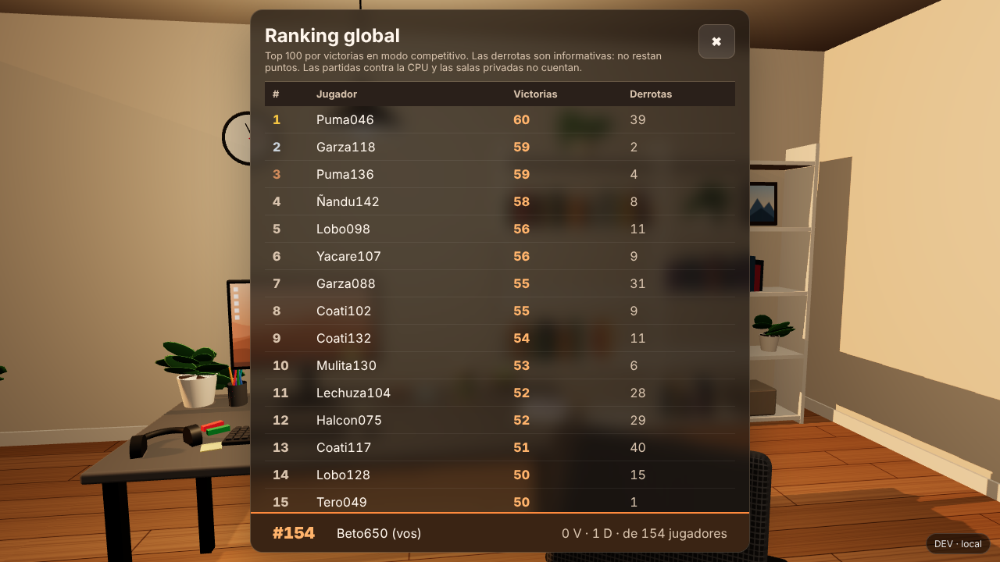
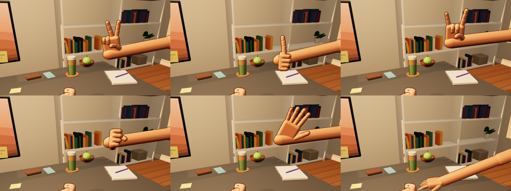

# Versión 2: modo competitivo, ranking antifraude y celebraciones

La V2 parte de la V1 (`git tag v1.0`) y mantiene el mismo pipeline de Jenkins. Las cosas
nuevas se integran solas en las etapas existentes:

- el módulo `matchmaking` entra al reactor de Maven;
- las pruebas nuevas corren en *Pruebas unitarias* y *Pruebas de integración*;
- el smoke test también verifica `/api/leaderboard`.

| Métrica | V1 | V2 |
|---|---|---|
| Módulos Maven | 3 | **4** (`+ matchmaking`) |
| Pruebas unitarias | 74 | **97** |
| Pruebas de integración | 9 | **22** |
| Versión de la imagen | `1.0.<build>` | `2.0.<build>` (sale del `pom.xml`) |

## 1. Funcionalidades

### Modo competitivo y matchmaking
- Botón **🏆 Competitivo**: crea (una sola vez) un **perfil competitivo** con el nombre del jugador. El
  servidor devuelve un `playerId` y un **token secreto**, que se guardan en el navegador.
- El jugador entra a una **cola**. El servidor lo empareja automáticamente con otro jugador con una
  **cantidad parecida de victorias competitivas**.
- Partida **al mejor de 3** (gana quien llega a 2 rondas). La celebración elegida se ejecuta al ganar la partida.
- Abandonar o cerrar el navegador a mitad de partida cuenta como **derrota por abandono**.

**Algoritmo** (`matchmaking/Matchmaker`):
1. Cada ticket guarda `victorias` y el instante en que entró a la cola.
2. La **tolerancia** arranca en ±1 victoria y se ensancha ±2 cada 5 s de espera (`MatchmakingPolicy`), para que nadie espere para siempre.
3. En cada *tick* (cada 500 ms y al encolar) se recorren los tickets **del más antiguo al más nuevo**. Para cada uno se busca, en un
   índice `TreeMap<victorias, tickets>`, el rival con **menor diferencia de victorias** dentro de su
   tolerancia (ante empate, el que más esperó). La búsqueda es O(log n + k).
4. Nunca empareja a un perfil consigo mismo, y un perfil no puede tener dos tickets.

La UI muestra el tiempo de espera y el rango de victorias que se está buscando en ese momento.

### Ranking global antifraude
- Estadísticas en tablas propias: `player_profile` (victorias, derrotas) y `competitive_match` (una fila por partida).
- **Solo `RankingService` escribe esas estadísticas, y solo lo invoca el modo competitivo.** Las partidas PvE y las
  salas casuales con código siguen usando el historial de V1 (`match_record`) y **no tienen acceso** a las
  estadísticas. Hay un test que juega 30 rondas PvE y verifica que el ranking no cambia (`CompetitiveWebSocketIT.pveWinsNeverAffectTheRanking`).
- Otras medidas antifraude:

| Ataque | Defensa |
|---|---|
| Farmear victorias contra la CPU | PvE nunca toca `player_profile` (separación por diseño + test) |
| Reportar un resultado falso desde el cliente | El cliente solo envía su jugada. El resultado lo calcula el servidor |
| Usar el `playerId` de otro | Cada acción competitiva exige el token. Se guarda su SHA-256 y se compara en tiempo constante |
| Suplantar un nombre (“Ana” vs “ana”) | Nombre único sin distinguir mayúsculas (`nameKey UNIQUE`) |
| Jugar contra uno mismo desde dos pestañas | Un perfil solo puede estar una vez en cola o en partida (`putIfAbsent`). El matchmaker rechaza tickets duplicados |
| Desconectarse cuando se va perdiendo | Abandono = derrota |
| Contar dos veces la misma partida | `matchId` es la clave primaria de `competitive_match` (idempotencia) |
| *Win-trading* con una cuenta cómplice | Contra el mismo rival solo cuentan **3 victorias por día**. El resto se registra con `counted = false` |

### Leaderboard Top 100



- `GET /api/leaderboard?playerId=…` devuelve el Top 100 numerado y la **posición global exacta** del jugador.
- Orden: victorias (desc), luego quién alcanzó primero esa cifra (`winsReachedAt`), luego id. **Las derrotas se
  muestran pero no afectan el orden.**
- La posición exacta se calcula con un `COUNT` de los jugadores “por delante” (consulta indexada por
  `wins, wins_reached_at, id`). No hace falta recorrer la tabla.
- En la UI, si el jugador está fuera del Top 100, aparece una barra **fija abajo** con `#posición`, sus V/D y el total de jugadores.
- En UAT, el pipeline levanta la app con `APP_DEMO_SEED=true`, que genera 150 jugadores ficticios. Así QA puede probar
  el caso “fuera del Top 100”. En producción nunca se activa.

### Celebraciones



Desde **🎉 Celebraciones** en el menú, el jugador elige su animación de victoria. Puede verla en 3D con
**Vista previa**. Se guarda en el navegador y en el perfil, y viaja en la información de la sala: **el rival ve tu
celebración**.

| Id | Animación (sobre el escritorio de la oficina) |
|---|---|
| `BOUNCE` | La mano rebota dos veces |
| `PEACE` | Signo de la paz ✌️, palma hacia el rival, con vaivén |
| `THUMBS_UP` | Pulgar arriba 👍 con dos “golpes” hacia adelante |
| `HORNS` | Cuernos rockeros 🤘 con *headbang* |
| `FIST_PUMP` | Puño al aire 💪, tres veces |
| `WAVE` | “Chau chau” 👋 burlón |
| `DRUM` | Tamborileo de dedos sobre la mesa 🥁 |
| `MIDDLE_FINGER` | Mala seña, **censurada con un mosaico pixelado** (dorso hacia el rival) |

Cómo se implementó (`arms.js`, `stage.js`):

- nuevas poses de dedos (`peace`, `thumbsUp`, `horns`, `middle`, `relaxed`) interpoladas como las de V1;
- `facePoint` / `faceBack` orientan la palma (o el dorso) hacia el rival;
- `handInner.rotation` permite los saludos;
- en el tamborileo, cada dedo se anima por separado;
- la censura es un `Sprite` con textura pixelada, enganchado a la falange del dedo medio.

En PvE y en salas casuales la celebración se ejecuta en cada ronda ganada. En competitivo, las rondas usan un rebote y la
celebración elegida se reserva para la victoria de la partida.

## 2. Ajustes arquitectónicos para la concurrencia

El modo competitivo agrega estado compartido que tocan varios hilos a la vez: los hilos de Tomcat (uno por mensaje
WebSocket), el hilo programado del matchmaking y las transacciones de base de datos.

```
 WebSocket (hilos Tomcat) ──► GameWebSocketHandler ──► CompetitiveService ──► Matchmaker (lock)
                                     │                       │   ▲ @Scheduled tick (500 ms)
                                     ▼                       ▼
                               RoomManager (synchronized)  RankingService (@Transactional, SQL atómico)
                                     │                       │
                                     └──► SessionRegistry ◄──┘  (envíos thread-safe a cada conexión)
```

1. **Cola con un único lock (`ReentrantLock`)**. `enqueue`, `cancel` y `tick` se serializan, así un ticket se
   empareja **o** se cancela exactamente una vez. Hay una prueba de estrés con 2.000 jugadores y 8 hilos que verifica que nadie
   queda en dos partidas ni en una partida después de cancelar (`MatchmakerConcurrencyTest`).
2. **Emparejamiento en un hilo programado** (`@Scheduled`), también disparado al encolar. Los dos caminos entran por el
   mismo lock. Un ticket se registra en `queuedBySession` *antes* de entrar a la cola, para que el tick no lo encuentre
   “a medias” (esta carrera se detectó al revisar el código y se corrigió).
3. **Un perfil, una actividad**: `ConcurrentHashMap.putIfAbsent(playerId, sessionId)` impide estar en cola o jugando
   desde dos pestañas o dispositivos.
4. **Cierre atómico de la partida**: la última jugada y un abandono pueden llegar al mismo tiempo desde hilos distintos.
   `RoomManager` (métodos `synchronized`) marca la sala como terminada con `finish()`, que devuelve `true` una sola vez.
   Hay una prueba que corre 200 carreras “jugada vs abandono” y verifica que siempre hay exactamente un resultado
   (`CompetitiveRoomTest.lastMoveAndForfeitRaceProducesSingleOutcome`).
5. **Persistencia idempotente y sin *lost updates***: `matchId` es la PK de `competitive_match` (un segundo cierre falla
   y se descarta). Victorias y derrotas se incrementan con `UPDATE … SET wins = wins + 1` (atómico en la base) en vez de
   leer, sumar y guardar. Además, la entidad tiene `@Version`.
6. **`SessionRegistry`** centraliza las conexiones y los “asientos” (sala + jugador). Cada sesión se envuelve en
   `ConcurrentWebSocketSessionDecorator`: el hilo del rival, el del matchmaking y el propio pueden enviar a la misma
   conexión sin corromper mensajes. Además, rompe la dependencia circular `handler ⇄ servicio competitivo`.
7. **Altas concurrentes de perfiles**: dos registros simultáneos con el mismo nombre los resuelve la restricción
   `UNIQUE` de la base: el segundo recibe `409 Conflict`.

### Escalabilidad (más allá del curso)
El matchmaker y las salas viven en memoria de **una** instancia. Para escalar horizontalmente habría que:

- mover la cola a un almacén compartido (por ejemplo Redis con *sorted sets* por victorias);
- mover el estado de las salas, o usar *sticky sessions*;
- reemplazar H2 por PostgreSQL. Las consultas del ranking ya son SQL estándar con índice.

## 3. API nueva

| Método | Ruta / mensaje | Descripción |
|---|---|---|
| POST | `/api/players` | Crea el perfil competitivo → `{playerId, token, name, celebration}` (409 si el nombre existe) |
| GET | `/api/players/{id}` | Victorias, derrotas y posición |
| PUT | `/api/players/{id}/celebration` (header `X-Player-Token`) | Cambia la celebración |
| GET | `/api/celebrations` | Celebraciones disponibles |
| GET | `/api/leaderboard?playerId=` | Top 100 + `me` (posición exacta) + `totalRanked` |
| WS | `QUEUE {playerId, token}` / `CANCEL_QUEUE` | Entrar a la cola o salir |
| WS | `QUEUED`, `MATCH_FOUND`, `ROUND_RESULT{matchOver}`, `MATCH_RESULT{counted, you:{wins,losses,position}}` | Mensajes del servidor |

## 4. Pruebas nuevas

| Clase | Tipo | Qué valida |
|---|---|---|
| `MatchmakerTest`, `MatchmakingPolicyTest` | Unit | Cercanía, prioridad por espera, ensanchamiento, sin auto-emparejamiento, cancelación |
| `MatchmakerConcurrencyTest` | Unit (estrés) | 2.000 jugadores y 8 hilos: nadie emparejado dos veces |
| `CompetitiveRoomTest` | Unit | Mejor de 3, abandono, cierre único con carrera, celebraciones |
| `RankingServiceIT` | Integración (H2) | Orden, desempates, derrotas informativas, Top 100 + posición exacta, idempotencia, anti win-trading |
| `CompetitiveWebSocketIT` | Integración (WS real) | Cola → partida → resultado → ranking, abandono, dos pestañas, token inválido, PvE no suma |
| `PlayerApiIT` | Integración (HTTP) | Alta, nombre duplicado, token inválido o válido |

## 5. Verificación realizada
- `./mvnw verify` en verde: 97 unitarias + 22 de integración.
- Etapas del pipeline ejecutadas en la imagen de Jenkins: build, pruebas, imagen `rps3d:2.0.5` y deploy + smoke en UAT
  (con 150 jugadores de demo). La corrida anterior (build 4, ya con el código V2 pero con el esquema de versión viejo `1.0.4`) también hizo deploy + smoke en PROD, y PROD quedó **sin** datos de demo (`totalRanked: 0`).
- Prueba E2E con dos navegadores (Playwright):
  1. Ana configura la celebración “Paz” y entra a la cola.
  2. Beto entra a la cola y los dos quedan emparejados.
  3. Ana gana 2-0 y queda #138 con 1V 0D. Beto queda #154 con 0V 1D.
  4. Beto abre el ranking: ve el Top 100 y su posición #154 fija abajo.
- Durante la prueba E2E apareció un bug: en competitivo los clics de jugada no se enviaban, porque el modo `ranked` no
  estaba contemplado. Se corrigió en `main.js`.
